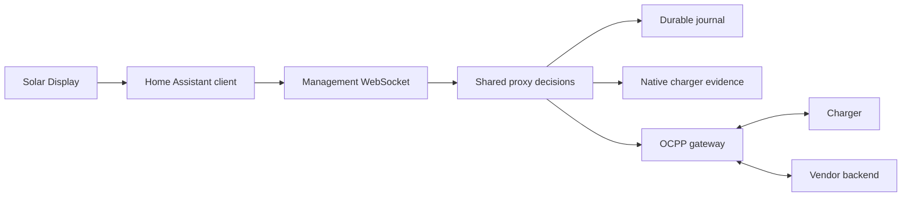

# Code navigation

The standalone service loads the ordinary Python package `ics_proxy_core`. The Home Assistant integration
has its own package at `custom_components/ics_proxy`. Open these entry points first.

| Area | Implementation | Regression starting point |
| --- | --- | --- |
| Service setup, supervision and reporting | [managed_proxy.py](../tools/managed_proxy.py), [trial_session.py](../ics_proxy_core/engine/trial_session.py), [runtime.py](../ics_proxy_core/engine/runtime.py) | [test_managed_service_cli.py](../tests/test_managed_service_cli.py) |
| Requests and durable intent | [managed_api.py](../ics_proxy_core/engine/managed_api.py), [managed_intent.py](../ics_proxy_core/engine/managed_intent.py), [managed.py](../ics_proxy_core/engine/managed.py) | [test_managed_api.py](../tests/test_managed_api.py) |
| Shared decisions and wire dispatch | [command_processor.py](../ics_proxy_core/engine/command_processor.py), [control_decisions.py](../ics_proxy_core/engine/control_decisions.py), [gateway.py](../ics_proxy_core/engine/gateway.py), [local_control.py](../ics_proxy_core/engine/local_control.py) | [test_control_authority.py](../tests/test_control_authority.py) |
| Start and current | [start_policy.py](../ics_proxy_core/engine/start_policy.py), [start_lifecycle.py](../ics_proxy_core/engine/start_lifecycle.py), [managed_charging.py](../ics_proxy_core/engine/managed_charging.py), [managed_current.py](../ics_proxy_core/engine/managed_current.py) | [test_managed_normal_start.py](../tests/test_managed_normal_start.py), [test_managed_current.py](../tests/test_managed_current.py) |
| Session-only Stop | [managed_session_stop.py](../ics_proxy_core/engine/managed_session_stop.py), [command_outcomes.py](../ics_proxy_core/engine/command_outcomes.py) | [test_managed_session_stop.py](../tests/test_managed_session_stop.py) |
| Native evidence and recovery | [native_bounded_handover.py](../ics_proxy_core/engine/native_bounded_handover.py), [recovery_control.py](../ics_proxy_core/engine/recovery_control.py), [native_history_recovery.py](../ics_proxy_core/engine/native_history_recovery.py) | [test_native_history_recovery.py](../tests/test_native_history_recovery.py) |
| Transactions and cloud delivery | [store.py](../ics_proxy_core/engine/store.py), [delivery_reply.py](../ics_proxy_core/engine/delivery_reply.py), [managed_stop_delivery.py](../ics_proxy_core/engine/managed_stop_delivery.py) | [test_managed_stop_reply_recovery.py](../tests/test_managed_stop_reply_recovery.py) |
| Read-only incident reports | [managed_incident.py](../tools/managed_incident.py), [managed_stop_incident.py](../tools/managed_stop_incident.py) | [Start](../tests/test_managed_incident.py), [Stop](../tests/test_managed_stop_incident.py) |
| HA client and display | [api.py](../custom_components/ics_proxy/api.py), [session_service.py](../custom_components/ics_proxy/session_service.py), [display example](../examples/solar-display-2/README.md) | [tests_ha_proxy](../tests_ha_proxy) |

## What to trace during a review

- Follow the management request into `ManagedController` and the shared `ControlDecisions`. The gateway and
  local executor use that same owner for the final send. Wire I/O can wait outside the short decision turn.
- Follow the same request through the journal and the physical observation. An accepted wire reply can precede
  the real Start or closing report. Home Assistant and the display keep the exact request and session identity.
- Use the same exact reply evidence during normal operation and recovery. The request, possible dispatch,
  definite charger reply, and verified physical outcome are separate facts. A refused reply write can leave an
  independent checkpoint for that attempt. Retrying publication uses that evidence without sending the command again.
- Check recovery before allowing positive current again. The owner combines the saved intent, current charger Boot,
  native evidence, and the journal. Reconciliation can preserve reports for normal delivery without performing a
  new charging action.
- Keep persisted keys and the reserved station profile ID stable across checkout layout changes. Historical
  rollback rehearsal still validates its known old layouts and builds.

## Follow a session Stop

1. `ManagedSessionStop.accept()` saves the Home Assistant request against the exact open session and current
   control revision. A vendor-app Stop reaches the gateway, which maps its transaction ID to the same local session.
   The shared decision records an earlier Stop that already covers this session when it accepts the request.
   The result then follows that earlier attempt even if the session closes while the request would have waited
   for the charger.
   [Local request](../ics_proxy_core/engine/managed_session_stop.py) · [Vendor request](../ics_proxy_core/engine/gateway.py)
2. Immediately before send, both paths use the shared Stop decision in `ControlDecisions`. The decision can allow
   a send on the original charger Boot, reuse an exact acceptance, wait for an earlier attempt's report, or find
   that the target is no longer open. If the session closes before dispatch and there was no earlier Stop to join,
   verified closure can satisfy the request. Possible dispatch is recorded before the wire send.
   [Shared decision](../ics_proxy_core/engine/control_decisions.py) · [Wire boundary](../ics_proxy_core/engine/rpc.py)
3. The charger reply is recorded against that attempt. A matching `Accepted` lets the owner wait for closure.
   The closing report and independent charger reading establish physical closure. The receipt can wait for the
   exact reply even after the session shows as closed. A definite rejection settles that attempt as failed,
   including when the reply is saved in a separate checkpoint. If the reply window ends without an answer,
   the verified closure can settle the receipt. The proxy retains verified closure while it retries a failed
   receipt write. An incident report can show the earlier accepted reply that a local request joined.
   [Command evidence](../ics_proxy_core/engine/command_outcomes.py) · [Stop settlement](../ics_proxy_core/engine/stop_settlement.py)

Session Stop leaves app or schedule mode in place. Pause claims a zero hold and can also stop the exact session.
With current independent zero evidence, Pause and the vendor app can wait for an unanswered Stop on the same
charger connection. A newer Pause can act after reconnecting. Lost zero or fresh draw can require a separately
authorized protective Stop. A distinct vendor request for a still-open session can send another Stop if the
proxy lacks a verified zero hold and no unresolved Stop already covers it. The
[settlement checks](../tools/check_control_settlement.py) cover both local and vendor request orders, including
lost replies and overlapping Pause.

## Follow a Return to app or schedule

1. `accept_return()` saves the request under the current Pause. `claim_restore_request()` can mark it running
   before charger checks begin. The physical ticket is claimed later.
   [Request and preflight](../ics_proxy_core/engine/control_decisions.py)
2. The recovery coordinator reads the charger. `prepare_release_attempt()` checks the fresh zero evidence and
   rechecks the original intent, connection, and ticket. It binds an explicit Return to that zero-hold ticket
   and Boot.
   [Recovery coordinator](../ics_proxy_core/engine/recovery_coordinator.py)
3. `claim_release()` takes the physical ticket. The local executor rechecks the guard at the wire boundary.
   A verified ceiling can publish shared control in `complete_release()`. Restoring zero uses the same release
   ticket and still checks the original Boot. [Local executor](../ics_proxy_core/engine/local_control.py)
4. `settle_release()` uses the attempt's actual send, reply, verification, and rollback evidence to decide
   whether to finish, wait, or record a fault. [Release policy](../ics_proxy_core/engine/recovery_policy.py)

The [developer guide](developer.md) describes the engine, model, Home Assistant, recovery discovery and installation
rehearsal test suites.
