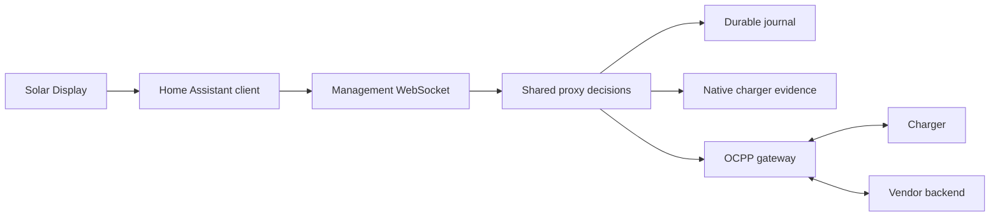

# Code navigation

The standalone service loads the ordinary Python package `ics_proxy_core`. The Home Assistant integration
has its own package at `custom_components/ics_proxy`. Open these entry points first.

| Area | Implementation | Regression starting point |
| --- | --- | --- |
| Service setup, supervision and reporting | [managed_proxy.py](../tools/managed_proxy.py), [trial_session.py](../ics_proxy_core/engine/trial_session.py), [runtime.py](../ics_proxy_core/engine/runtime.py) | [test_managed_service_cli.py](../tests/test_managed_service_cli.py) |
| Requests and durable intent | [managed_api.py](../ics_proxy_core/engine/managed_api.py), [managed_intent.py](../ics_proxy_core/engine/managed_intent.py), [managed.py](../ics_proxy_core/engine/managed.py) | [test_managed_api.py](../tests/test_managed_api.py) |
| Shared decisions and wire dispatch | [command_processor.py](../ics_proxy_core/engine/command_processor.py), [control_decisions.py](../ics_proxy_core/engine/control_decisions.py), [gateway.py](../ics_proxy_core/engine/gateway.py), [local_control.py](../ics_proxy_core/engine/local_control.py) | [test_control_authority.py](../tests/test_control_authority.py) |
| Start and current | [start_lifecycle.py](../ics_proxy_core/engine/start_lifecycle.py), [managed_charging.py](../ics_proxy_core/engine/managed_charging.py), [managed_current.py](../ics_proxy_core/engine/managed_current.py) | [test_managed_normal_start.py](../tests/test_managed_normal_start.py), [test_managed_current.py](../tests/test_managed_current.py) |
| Session-only Stop | [managed_session_stop.py](../ics_proxy_core/engine/managed_session_stop.py), [command_outcomes.py](../ics_proxy_core/engine/command_outcomes.py) | [test_managed_session_stop.py](../tests/test_managed_session_stop.py) |
| Native evidence and recovery | [native_bounded_handover.py](../ics_proxy_core/engine/native_bounded_handover.py), [recovery_control.py](../ics_proxy_core/engine/recovery_control.py), [native_history_recovery.py](../ics_proxy_core/engine/native_history_recovery.py) | [test_native_history_recovery.py](../tests/test_native_history_recovery.py) |
| Transactions and cloud delivery | [store.py](../ics_proxy_core/engine/store.py), [delivery_reply.py](../ics_proxy_core/engine/delivery_reply.py), [managed_stop_delivery.py](../ics_proxy_core/engine/managed_stop_delivery.py) | [test_managed_stop_reply_recovery.py](../tests/test_managed_stop_reply_recovery.py) |
| HA client and display | [api.py](../custom_components/ics_proxy/api.py), [session_service.py](../custom_components/ics_proxy/session_service.py), [display example](../examples/solar-display-2/README.md) | [tests_ha_proxy](../tests_ha_proxy) |

## What to trace during a review

- Follow the management request into `ManagedController` and the shared `ControlDecisions`. The gateway and
  local executor use that same owner for the final send. Wire I/O can wait outside the short decision turn.
- Follow the same request through the journal and the physical observation. An accepted wire reply can precede
  the real Start or closing report. Home Assistant and the display keep the exact request and session identity.
- Compare the session Stop and Pause paths. A session Stop closes the exact session while retaining app or schedule
  mode. An uncertain ordinary Stop is tied to its original attempt. A protective Pause can hold at zero and stop the
  exact session under the shared controller.
- Check recovery before allowing positive current again. The owner combines the saved intent, current charger Boot,
  native evidence, and the journal. Reconciliation can preserve reports for normal delivery without performing a
  new charging action.
- Keep persisted keys and the reserved station profile ID stable across checkout layout changes. Historical
  rollback rehearsal still validates its known old layouts and builds.

The [developer guide](developer.md) describes the engine, model, Home Assistant, recovery discovery and installation
rehearsal test suites.
